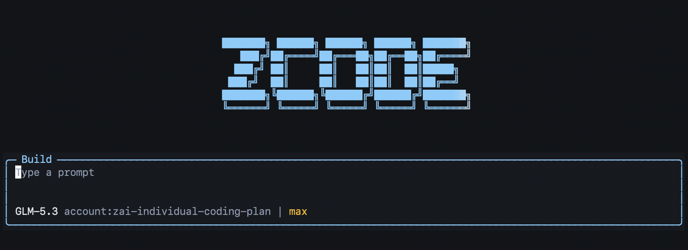

# ZUSC: zcode-unofficial-standalone-cli

**Z**code **U**nofficial **S**tandalone **C**LI.



> **Unofficial.** This project is not affiliated with or endorsed by Z.AI.

Installs the official ZCode CLI/TUI as the `zcode` command: a standalone terminal harness for Z.ai GLM models such as GLM-5.3, usable with a GLM Coding Plan subscription. It builds the official source of [zai-org/ZCode](https://github.com/zai-org/ZCode) (Apache-2.0) with the official build command. Z.AI currently distributes ZCode as a desktop app only; the CLI source is public but requires monorepo build knowledge. This tool fills that gap.

[한국어 문서 (docs/README.ko.md)](docs/README.ko.md)

> **Account note (upstream bug, as of 2026-10):** on a machine that has never run the ZCode desktop app, `zcode login` completes but the token it issues is rejected by the model API. A **one time sign in through the desktop app** is currently required to provision working credentials. After that, the CLI runs fully standalone. Details in [Account setup](#account-setup-and-the-current-one-time-desktop-requirement), tracked upstream as [zai-org/feedback#1001](https://github.com/zai-org/feedback/issues/1001).

## When to use this

- **Stability of the official harness.** What gets installed is the official CLI itself: same version numbering, same TUI, same session and credential surface as the desktop app. There is no wrapper layer, no extracted binaries and no custom UI. You always run upstream code, built as upstream builds it.
- **Standalone use inside ADEs such as Orca.** Agent development environments map agent slots to harnesses one to one (claude goes with Claude Code, codex goes with Codex). GLM needs its own dedicated harness slot. Because this installs the official `zcode` identity, ADEs recognize it as the official CLI. Verified in Orca with `worktree create --agent zcode`.
- **You want a terminal workflow without monorepo overhead.** No pnpm, workspace or lockfile knowledge needed. One command builds and installs everything.
- **You prefer verifiable installs.** The script downloads the official tag tarball from GitHub and builds on your machine. Nothing prebuilt is executed.

## Supported platforms

| Platform | Status |
|---|---|
| macOS (Apple Silicon, arm64) | Verified. Install, TUI, headless, `zcode login` and Orca integration all tested |
| macOS (Intel, x64) | Expected to work, not yet tested |
| Linux (x64, ARM64) | Expected to work, not yet tested |
| Windows | Not supported. WSL is untested |

## Requirements

To get the installer:

| Component | Required | Notes |
|---|---|---|
| git | recommended | the easiest way to clone this repository, but not required: see the ZIP download alternative below |

To run the installer, and later to run the CLI itself:

| Component | Required | Notes |
|---|---|---|
| Node.js | yes, 24 or newer | needed at install time and as the CLI runtime (the CLI uses `node:sqlite`, stable since Node 24, so older Node breaks the CLI itself). Verified with 24.x and 26.x. The exact `24.14.0` you may see in upstream files is their development pin, not a requirement: any Node 24 or newer from nodejs.org works, no nvm or version pinning knowledge needed. The installer checks your version first and stops with a clear message if it is too old. |
| Network | yes | GitHub (source, tags) and the npm registry |

To sign in (one time, upstream bug workaround):

| Component | Required | Notes |
|---|---|---|
| ZCode desktop app | once | Install it, sign in once, then quit. This provisions the working credential (see the note at the top and [feedback#1001](https://github.com/zai-org/feedback/issues/1001)). Not needed to run or use the CLI afterwards. Expect to need it again if you switch accounts or when the credential needs renewing. |

The install itself needs only Node.js and network. git, curl, pnpm, corepack and even the OS `tar` command are not needed either: everything else the build requires is installed automatically in isolation under `~/.zcode-cli/tools`, and your global environment is never modified.

On a fresh macOS, if native dependency steps complain, install Xcode Command Line Tools with `xcode-select --install`.

## Account setup and the current one time desktop requirement

Authentication is a two step design. `zcode login` first obtains an OAuth identity token, then the CLI exchanges it at `api.z.ai/api/auth/z/login` for the coding plan API key that the model API actually accepts. Two defects combine today:

1. The exchange is rejected by the server for CLI issued tokens ("Z.ai user information is invalid", reported as [zai-org/feedback#1001](https://github.com/zai-org/feedback/issues/1001); we reproduced the end to end failure on macOS as well).
2. When the exchange fails, the CLI silently falls back to sending the raw OAuth token as if it were the API key (`business?.token ?? oauth` in the shipped bundle). So instead of a clear "credential exchange failed" you get a misleading 401 "Invalid Authentication Token" at the model API. A fingerprint of this state in your own logs is `"account_uuid":""` inside the request metadata.

What this means in practice:

- On a machine where the desktop app is or was installed, the working API key credential already exists in `~/.zcode/v2/credentials.json` and the CLI picks it up automatically. The CLI then runs fully standalone.
- On a clean machine, the desktop app is currently needed once, purely to provision that credential. Copying `~/.zcode/v2/credentials.json` from a provisioned machine also works.
- Once Z.AI fixes the exchange endpoint, the one time requirement disappears and `zcode login` alone will be enough.

## Install

With git:

```bash
git clone https://github.com/dooee/zcode-unofficial-standalone-cli.git
cd zcode-unofficial-standalone-cli
./install.sh
```

Without git (ZIP download): open this repository on GitHub, click the green **Code** button and choose **Download ZIP**, then extract it and run the installer (`unzip` ships with macOS, or use any archive tool):

```bash
unzip zcode-unofficial-standalone-cli-main.zip
cd zcode-unofficial-standalone-cli-main
./install.sh
```

The install script itself never uses git: it downloads the official ZCode source tarball with Node.js fetch.

Other forms:

```bash
./install.sh --latest          # newest official tag
./install.sh --tag v3.15.1     # a specific tag
./install.sh --lang ko         # Korean messages (default: en)
./install.sh --force           # rebuild even when the same tag is installed
```

After installing:

```bash
zcode          # TUI
zcode -p "hi"  # headless one-shot
```

Account provisioning (one time, due to the upstream bug noted above): install the ZCode desktop app, sign in there once, then quit. The CLI automatically reuses the credential it writes. `zcode login` alone currently leads to 401 errors on clean machines; once Z.AI fixes [#1001](https://github.com/zai-org/feedback/issues/1001) it will be enough on its own.

If `~/.local/bin` was not on your PATH, the installer prints the exact lines to add to your shell profile, plus the `source` command to apply them. This matters because a PATH change never affects the terminal session you are already in: run the printed `source` line or open a new terminal before the first `zcode` call.

## Versioning and releases

Two version lines exist on purpose:

- **This installer** follows its own semver (`~/.zcode-cli/INSTALLER_VERSION`, current 0.4.0). Changes are tracked through git history and GitHub Releases of this repository.
- **The installed CLI** follows upstream tags (recorded in `~/.zcode-cli/INSTALLED`, for example v3.15.1). Upstream versioning is never mixed into this repository: built artifacts are not committed anywhere, every user builds from the official tag tarball on their own machine.

## Updates

Two mechanisms, both notification first and execution only on request:

- `zcode-update` shows the installed tag versus the newest official tag. With `--apply` it rebuilds with the newer tag.
- The installed `zcode` command also checks at most once a day (cache under `~/.zcode-cli`). When a new ZCode version has been released it prints a notice saying zcode-unofficial-standalone-cli needs an update, then starts the CLI normally. The check has a 4 second timeout and stays silent on network failure, so it never blocks your work.

Layout after install:

```
~/.zcode-cli/
  INSTALLED              # installed tag, e.g. v3.15.1
  LANG                   # message language (en or ko)
  src/                   # official source and build output
  tools/                 # isolated build tooling (installed automatically)
  bin/                   # install.sh copy, update checker
  cache/                 # downloaded tarballs
~/.local/bin/zcode           # wrapper: daily notice, then execs the official binary
~/.local/bin/zcode-update    # on-demand update check / apply
```

Builds happen in a fresh directory that is swapped in only after success, so a failed update never breaks the current installation.

## Verification history

| Item | Date | Environment | Result |
|---|---|---|---|
| v3.15.1 full install | 2026-10-11 | macOS arm64, Node 24 and Node 26 | install, TUI, headless `-p`, account link, Orca `--agent zcode` all verified |
| `zcode login` (OAuth) | 2026-10-11 | macOS arm64 | flow completes, but on a clean credential store the token is rejected by the model API (upstream [#1001](https://github.com/zai-org/feedback/issues/1001)); the desktop issued API key works |

## Troubleshooting

**`zcode -p` fails with `Unauthorized` / 401**

Two distinct causes share this symptom:

1. Clean machine, first login was `zcode login` (OAuth): the stored token is rejected by the model API. Upstream bug, see [zai-org/feedback#1001](https://github.com/zai-org/feedback/issues/1001) and the Account setup section above.
2. The CLI and ZCode Desktop share `~/.zcode/v2/credentials.json`. Running `zcode login` while Desktop is active can flip `account-provider:...:auth-source` from `manual` to `oauth` and invalidate a working setup, because the API key path is what actually works. Restoring that value to `manual` fixes it.

## Limitations

- Build based, so install and update take a few minutes.
- Verified on macOS arm64 only. Linux should work with the same path but is untested.
- Windows is unsupported (WSL untested).
- `ZCode` and `Z.AI` are trademarks of Z.AI. This project only automates building their Apache-2.0 source.

## License

- This repository (scripts and docs): **MIT**
- What gets built, ZCode source: **Apache-2.0**, copyright and notices belong to its authors

## Contributing translations

Installer messages live in `lang/en.sh` and `lang/ko.sh` as plain variable assignments. To improve a translation or add a language, copy `lang/en.sh` to a new file, translate the values (keep `%s` placeholders), and set `--lang` accordingly. No shell logic changes are needed.
